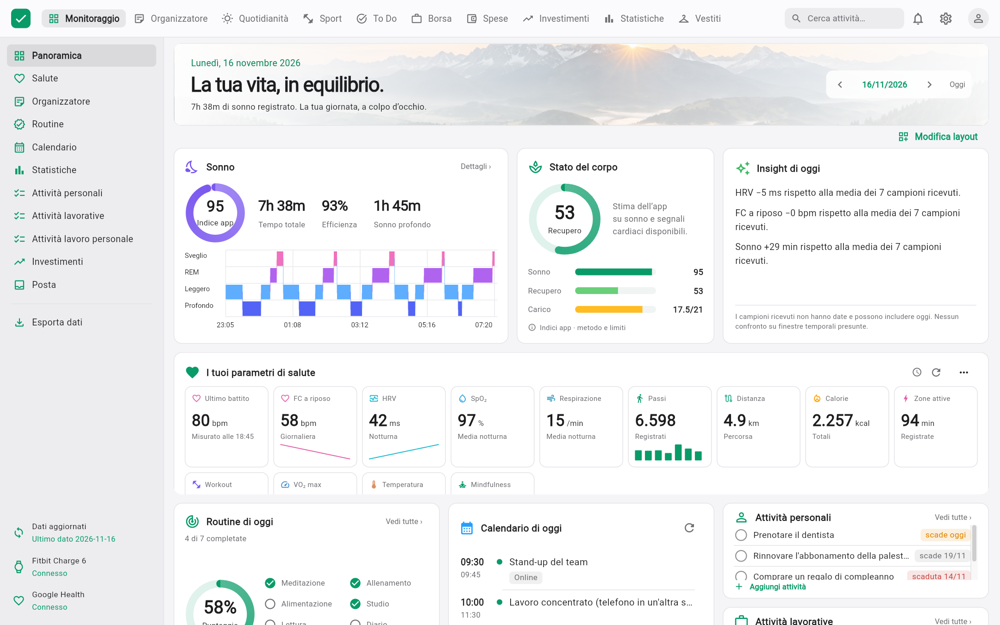
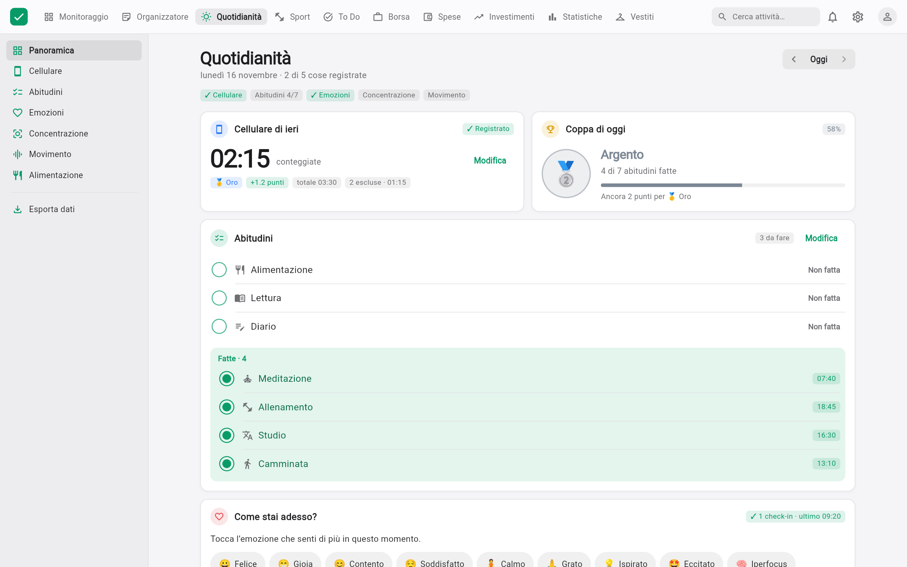
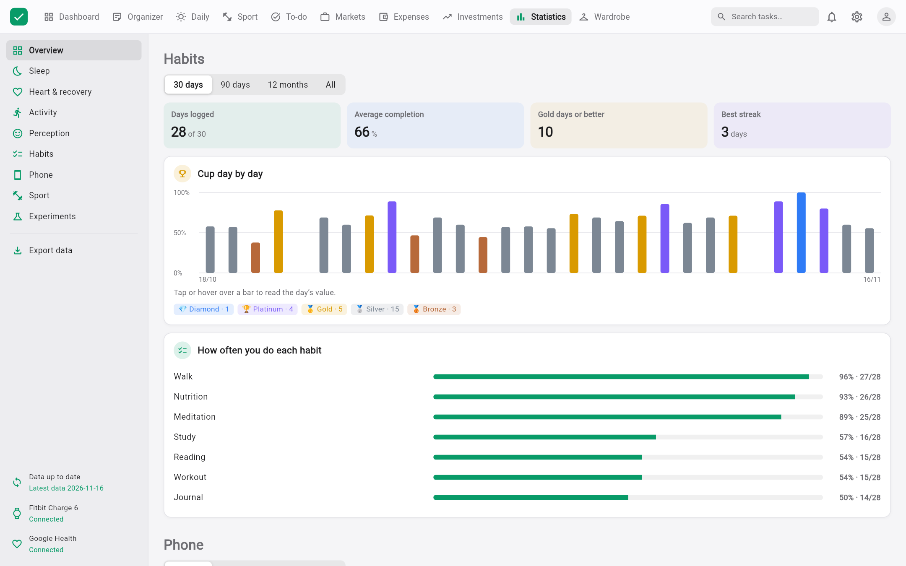
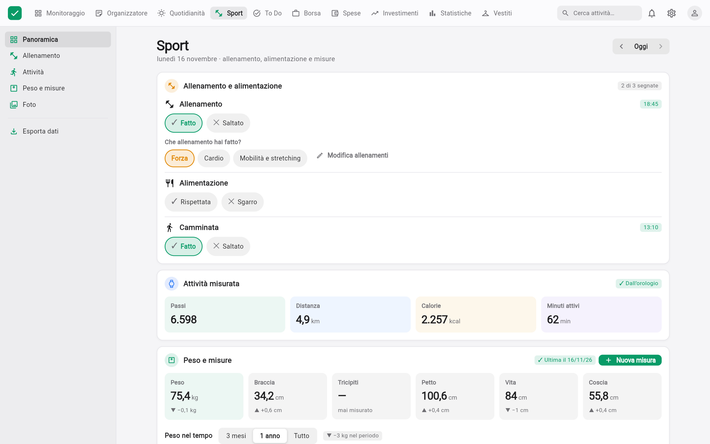
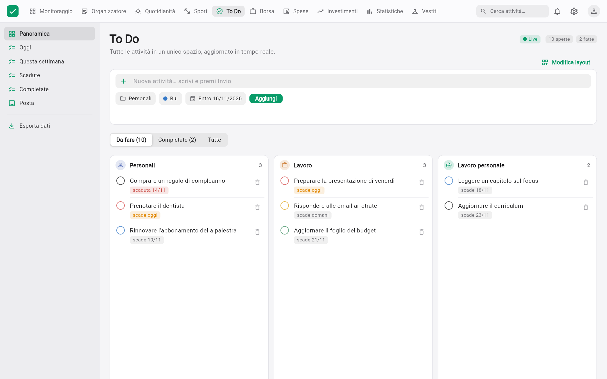
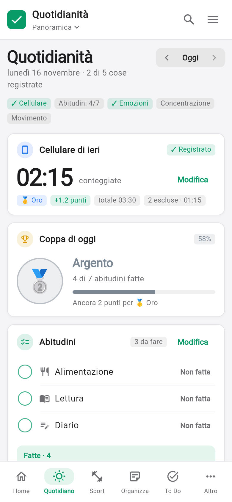

# 🧠⚡ DopaDash

**The ADHD-friendly life dashboard.** Habits, tasks, projects and health data
from your Fitbit in one colourful place that shows one thing at a time and
rewards every small step with a little hit of dopamine.

> 🇬🇧 🇮🇹 **English and Italian.** The app follows your browser language, and you
> can switch any time from *Account & settings*.

[dopadash-demo-en.webm](https://github.com/user-attachments/assets/98380361-a12d-4d69-b573-8c8d224b24f8)



<sub>All screenshots come from the built-in demo. Every number, habit and task in them is invented.</sub>

## Try the demo in one minute

No account, no database and no watch needed. The demo runs the real app
with generated data:

```powershell
flutter pub get
flutter run -d chrome -t tool/demo_app.dart
```

Add `?lang=it` or `?lang=en` to the address to pick the language.

## Why ADHD-friendly?

Most productivity apps are built for brains that like long lists and quiet
grey screens. DopaDash is built for brains that don't.

- **One thing at a time.** Each section shows only what matters right now.
- **Instant feedback.** Completion rings, colours and small milestones make
  progress visible, so the day feels winnable.
- **Low friction.** Tick a habit with one tap and capture a task straight into
  the Inbox before it slips away.
- **Personal experiments.** Try a change (say, no coffee after 2 pm) and compare
  how your sleep, mood and activity respond. The comparison is descriptive, not
  medical advice.

## Features

| Area | What it does |
| --- | --- |
| **Daily** | Today's habits with sub-activities, mood, screen time and recaps. |
| **To-do** | Personal and work tasks with due dates and colours. |
| **Organizer** | Projects, note sheets, an Inbox and a weekly review. |
| **Statistics** | Sleep, heart rate, activity, habit streaks and experiments over time. |
| **Fitbit health** | Sleep stages, resting heart rate, SpO₂, steps and more (via the Google Health API). |
| **Sport & body** | Workouts, body measurements and progress photos. |
| **Nutrition** | Custom meal plans with weekly limits and a daily tracker. |
| **Wardrobe** | Layered outfits built from photos of your own clothes. |
| **Money** | Monthly spending from an Excel file, plus a portfolio and market tracker. |
| **Export** | All your data in a single Excel workbook. |

The default habits are only a starting point. You can rename, remove or add
your own.

## Screenshots

| Daily: habits, screen time and today's cup | Statistics: how each habit is going |
| --- | --- |
|  |  |
| **Sport: workouts, Fitbit activity and body measurements** | **To-do: personal and work tasks with due dates** |
|  |  |

<p align="center">
  <br>
  <sub>It works on your phone too.</sub>
</p>

## Tech stack

- **App:** [Flutter](https://flutter.dev) for the web and Windows.
- **Data and auth:** [Supabase](https://supabase.com) (Postgres with Row Level
  Security, email login with optional two-factor authentication).
- **Optional backend:** a Cloudflare Worker for Fitbit, Outlook calendar and a
  Telegram assistant. See [`backend/personal_agent`](backend/personal_agent/README.md).

## Getting started

### 1. Requirements

- Flutter (stable channel, Dart ≥ 3.12)
- Node.js ≥ 22 (only for the local server and the backend)
- A free Supabase project

### 2. Database

In your Supabase project open the **SQL Editor** and run the files in
[`supabase/migrations`](supabase/migrations) in date order.

### 3. Configuration

```powershell
Copy-Item config/dart_defines.example.json config/dart_defines.local.json
```

Open `config/dart_defines.local.json` and add your Supabase URL and
*publishable* key. Git ignores this file, so it stays on your machine.

### 4. Run it

```powershell
flutter pub get
flutter build web --dart-define-from-file=config/dart_defines.local.json
node tool/serve-local.mjs build/web 7358
```

Then open <http://localhost:7358>. On Windows you can also double-click
`Avvia sito locale.cmd` after building.

### 5. Connect Fitbit (optional)

Fitbit data flows through the optional Cloudflare Worker, so access tokens
never reach the browser. Follow the steps in
[`backend/personal_agent/README.md`](backend/personal_agent/README.md#fitbit-facoltativo).

### 6. Tests

```powershell
flutter test
```

## Privacy

Each installation has a single owner. Your data lives in **your own** Supabase
project. Secret keys (Supabase service role, OpenAI, Telegram, Microsoft,
Google) live only in the Worker's secrets, never in the app or the repository.

## Project status

DopaDash is a personal project shared as it is, and it is still growing. Known
gaps:

- some tables the app reads (habits, mood, screen time, measurements, photos,
  meal plans) don't have a migration in this repository yet;
- sign-in and the main screens (Dashboard, Daily, Sport, To-do and the
  statistics summaries) are in English and Italian; the other sections are still
  Italian only, and translations are very welcome;
- the Money section expects an Excel file with a specific layout.

Ideas, bug reports and pull requests are welcome. Open an *Issue* to start.

If DopaDash helps your brain, consider leaving a ⭐: it helps other people
with ADHD find it.

## Disclaimer

DopaDash is not a medical device and does not give medical advice. Fitbit is a
trademark of Google LLC. This project is not affiliated with or endorsed by
Google or Fitbit.

## License

[MIT](LICENSE)
